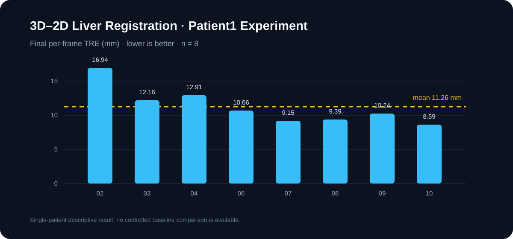

# 3D–2D Rigid Registration

A reproducible research pipeline for rigid liver registration from laparoscopic imagery and ultrasound, built around iterative RefineNet pose refinement. This repository contains the implementation and aggregate experiment metrics.



**Saved Patient1 experiment (8 frames):** mean per-frame TRE **11.26 mm**; IC passed on **4/8** frames. The global evaluation protocol reports **8.95 mm TRE** and **IC Failed**. 

[Installation](#installation) · [Reproduce evaluation](#reproduce-evaluation) · [Data access](#data-access) · [License](#license) · [中文说明](#中文说明)

## Included

- RefineNet model and pose refinement/inference pipeline.
- Depth Anything V2 integration and shared rendering, masking, and evaluation utilities.
- Scripts for preparation, synthetic pose-pair generation, training, inference, and TRE/IC evaluation.
- Aggregate metrics and a compact visualization of the saved experiment.

## Installation

Python 3.12 was used for the saved environment. Install a compatible PyTorch/torchvision build, then install project dependencies:

```bash
python -m pip install -r requirements.txt
python run.py check --deep
```

Choose a PyTorch wheel matching your CUDA or CPU setup with the [official installation selector](https://pytorch.org/get-started/locally/). Depth Anything V2 Large weights are not included; download the checkpoint from the [official repository](https://github.com/DepthAnything/Depth-Anything-V2) and place it at `weights/depth_anything_v2_vitl.pth`.

## Reproduce evaluation

Obtain authorized data as described below and recreate patient-specific intermediates by following the scripts. Evaluate an existing result archive with:

```bash
python run.py evaluate --include-debug
```

Run inference after preparing data and model weights:

```bash
python run.py infer --frames all
```

Run `python run.py --help` for available commands. Experiment settings are in `configs/patient1_fullres.env`.

## Data access

Patient data and all derived patient-specific artifacts are excluded from this public repository, including images, annotations, meshes, poses, depth maps, evaluation dumps, experiment archives, and trained checkpoints. Obtain data directly from the providers and follow their terms:

- EnCoV liver registration evaluation dataset: [Dataset_v1p0.zip](https://encov.ip.uca.fr/ab/code_and_datasets/datasets/llr_reg_evaluation_by_lus/Dataset_v1p0.zip)
- Koo et al. contours and simplified models: [Data_2017_Koo_etal_v1p0.zip](https://encov.ip.uca.fr/ab/code_and_datasets/datasets/llr_reg_evaluation_by_lus/Data_2017_Koo_etal_v1p0.zip)

Upstream archive hashes and layout notes are in [`data/raw/SOURCES.md`](data/raw/SOURCES.md). These links and hashes do not grant redistribution rights.

## License

Original project code is released under MIT. Third-party components retain their own licenses; see [`THIRD_PARTY_NOTICES.md`](THIRD_PARTY_NOTICES.md). Dataset terms are set by their providers and are not covered by the project license.

## 中文说明

本项目提供基于 RefineNet 的肝脏腹腔镜图像与术中超声刚性配准研究代码。公开仓库只包含实现代码和汇总指标。

已保存的 Patient1 实验共评估 8 帧：逐帧 TRE 均值 **11.26 mm**，IC 通过 **4/8**；全帧全局评价协议的 TRE 为 **8.95 mm**，IC 未通过。

请从数据提供方获取数据并遵守其使用条款。安装、运行和复现说明见上方英文部分。
